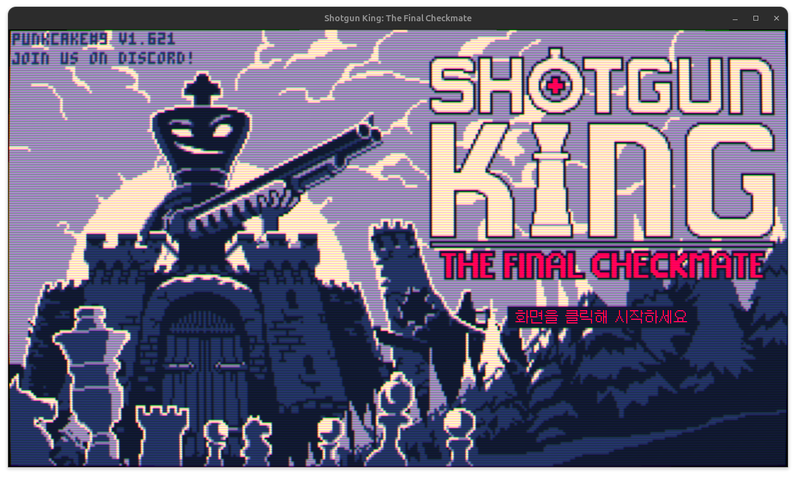

# Shotgun King RL



A screen-based Shotgun King agent with screenshot annotation and experimental reinforcement learning.

## Setup

```bash
python3 -m venv .venv
.venv/bin/python -m pip install -e .
```

## Usage

Put screenshots from one play session in `data/collection/inbox/`, process them, then open the review screen:

```bash
.venv/bin/python tools/process_collection.py --session SESSION_ID
./scripts/run_review.sh
```

Processing classifies the current inbox and creates annotation drafts, then exits. Reuse the session ID for the same play session and review the predictions before using them as labels.

To collect while you play, start automatic capture with the game window open:

```bash
./scripts/run_collect.sh
```

Capture saves only screens the current readers cannot fully read, such as unreadable stat rows or rarely reviewed values, and records the reasons shown during review. Stop with Ctrl+C. The session ID defaults to today's date and the next run number; pass `--session SESSION_ID` to resume one, `--review` to open the review page afterwards, or `--save-all` to keep every settled screen change.

To use a trained model, open Shotgun King in a visible window and run suggestion mode:

```bash
.venv/bin/python train.py --mode suggest
```

Suggestion mode requires an existing checkpoint and asks for confirmation before actions. Set the checkpoint path, weapon, rank and floor in [config.yaml](config.yaml) to match the game. Unresolved perception values block actions. Move the pointer to the top-left corner to trigger the emergency stop.

## Training

With the game open and configured as above, start reinforcement learning:

```bash
.venv/bin/python train.py --mode train
```

Set `episodes`, `max_steps_per_episode`, `batch_size` and `learning_rate` in `config.yaml`. Training controls the live game and saves the model at `model_path` (default: `models/model.pth`). Screenshot processing does not train the model.
