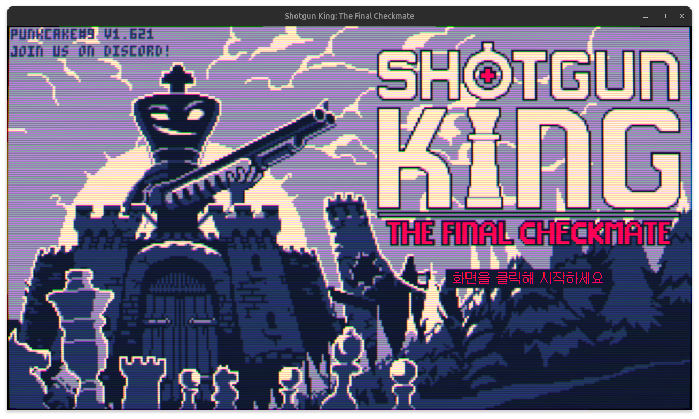

# Shotgun King RL



This project is rebuilding a screen-based Shotgun King agent with reviewed gameplay data. The maintained workflow imports screenshots, supports local annotation review, and builds datasets for piece and screen-state recognition.

The live-control and DQN runtime is experimental. Reliable screen recognition and environment transitions are being established before further training.

## Setup

```bash
python -m venv .venv
.venv/bin/python -m pip install -e .
```

The project uses standard Python packaging and does not require a specific package manager.

## Data workflow

1. Put private screenshots from one play session in `data/collection/inbox/`.
2. Run `./scripts/process_session.sh SESSION_ID` to prepare the session and open its review page.
3. Review board labels and page information, then stop the server with Ctrl+C to print the collection audit.
4. Build an immutable dataset with `.venv/bin/python tools/preprocess/build_piece_dataset.py --output data/collection/datasets/NAME`.

Screenshots from the same play session must use one session ID and one train, validation, or test split.

Benchmark reviewed train/validation screens offline before and after a change with the same inputs. Test images are excluded; `--include-hud` also measures the individual combat readers. Reports include predictions, evaluation metrics, source/input hashes, and timings, excluding image loading and reference construction.

```bash
.venv/bin/python tools/preprocess/benchmark_readers.py --include-hud --output data/collection/reports/benchmark_before.json
.venv/bin/python tools/preprocess/benchmark_readers.py --include-hud --baseline data/collection/reports/benchmark_before.json --output data/collection/reports/benchmark_after.json
```

Piece templates, screenshots, annotations, datasets, and model checkpoints remain local and are excluded from Git. Only documentation assets under `docs/assets/` are published.

## Experimental runtime

The legacy runtime requires Shotgun King in a visible 1280x720 window:

```bash
.venv/bin/python train.py
```

The assistance scope accepts every registered weapon preset. Rank scaling comes from configuration, while floor is recorded for context and does not restrict support. The operator must confirm the weapon, rank and floor on the game screen and ensure card and buff effects match the runtime configuration.

Runtime modes are explicit: `suggest` requires human confirmation, `collect` gathers autonomous traces with fixed exploration, and `evaluate` runs a greedy policy. These three modes never update or save the model. Only `train` writes replay updates and checkpoints; `suggest` and `evaluate` require an existing readable checkpoint.

Each attempted runtime action is appended to a private JSONL session under `data/runtime_traces`. The trace records the observed state, valid actions, recommendation, selected action, input and completion results, and whether the transition entered replay memory.

Move the mouse pointer to the top-left corner to trigger the emergency stop. Data tools do not start reinforcement-learning training.
